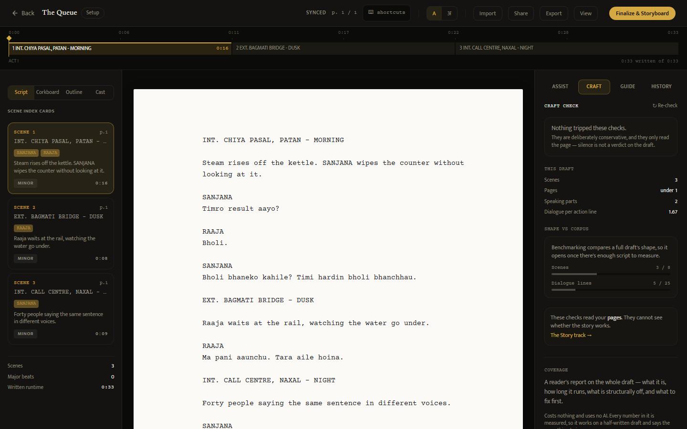
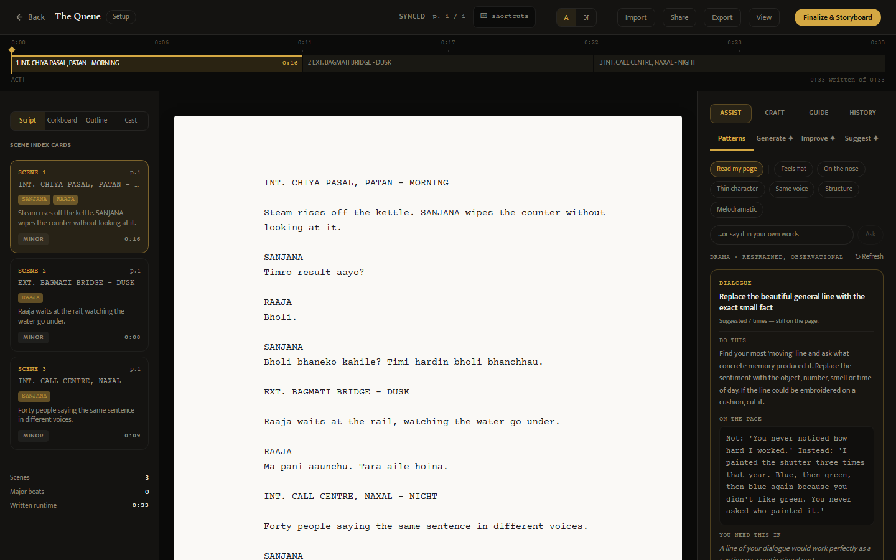
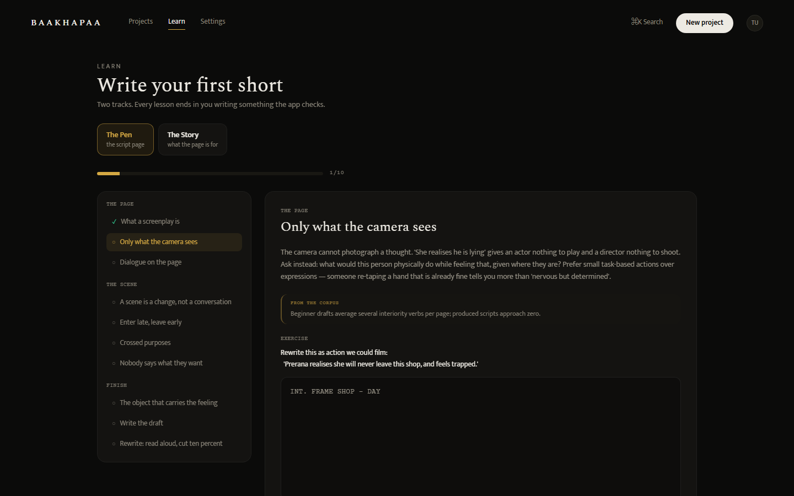
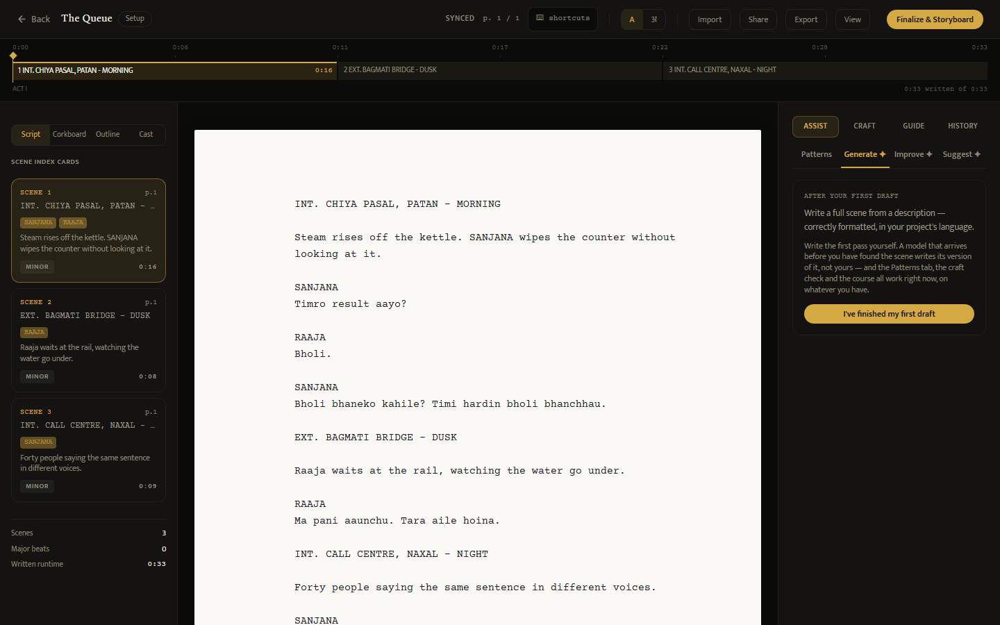

# Month 3 progress report

**Baakhapaa: AI-powered pre-production intelligence system**
Weeks 9 to 12 of 12  ·  Prepared for Baakhapaa  ·  Reference: proposal §8

The three items Month 2 named as blocking everything else were strictly ordered, and the
first two are done. A cloud database was created and its migrations applied; the application
was deployed on 15 September and has been running since. The third — merchant applications to
Khalti and eSewa — is not a build task and has not moved.

**161 of 200 planned tasks are complete.** The honest shape of the remaining 39 is the most
useful thing in this report: **29 of them are not work.** They are purchases and a person
holding a phone. No amount of engineering moves them, and the month ends with the product
built and a specific, short list of things that must be bought before it can be proven.

The month's second result is less comfortable. Half the commits answered no checkbox on the
plan, because **ten defects were found that were on no list at all** — six of them invisible
to the test suite as it then stood. That distribution is itself a finding, and section 6
treats it as one.

## 1. What the month produced

| | |
|---|---|
| Planned tasks complete | 161 of 200 |
| Remaining tasks blocked on a purchase or a person | 29 of 39 |
| Commits | 150 |
| Suite size | 1,146 backend tests in 75 files; 1,281 frontend tests in 66 files |
| Defects found that were on no plan | 10, of which 6 were invisible to the suite |
| Retrieval, real queries | **91.3%** combined, **90.0%** screenplay, measured this week |
| Deployed | 15 September, Vercel + Railway + Supabase |
| Real money moved | None |

## 2. The proposal's three blocking items

**A cloud database, migrations applied — done.** The email-normalisation migration ran first
and alone, as planned, because it was the only one that could fail on existing data. The
others followed. Two migrations are applied by hand in the SQL editor and a new Supabase
project would still need them; `check_schema.py` now asks the real database whether each
table matches what the code writes, so this is answered by the database rather than by a
document. That check caught a claim in our own notes that a table was unapplied when it had
existed for weeks.

**Deployment — done, 15 September.** It exercised the production configuration checks for the
first time, which is what they were written for: the backend refuses to start on an unset
origin list, a demonstration account left enabled, a local database file, or a Devanagari font
resolving only to the non-redistributable one. Register, login, project creation, draft save,
cast, lint, recommendations and review all return 200 against the deployed pair. Scene sync
reconciled a Devanagari draft in production Postgres.

Three environment-variable traps cost an hour between them and are written down in
`DEPLOYMENT.md` so they cost nobody else one.

**Merchant applications — not started.** Both require company registration and a business
bank account alongside the live URL. This is the item the proposal correctly identified as
depending on somebody else's calendar.

## 3. What a writer can do today, and what it costs

The product has two halves, and only one of them needs money to run.

**The free half works and was the month's main beneficiary.** The craft linter, the Patterns
tab, the coverage report, the corpus benchmark, the nineteen-lesson course and all four
exports run with **no AI call at all**. They work on a half-written draft, cost nothing per
use, and give the same answer twice.

*Figure 1 — the linter, the draft's own statistics and the corpus benchmark. Every number here
is counted, not generated. Nothing in this view makes a paid API call.*

Retrieval became diagnosis-first this month: rather than answering a complaint the writer
types, it reads the draft, names what it found and anchors each craft entry to a line.

*Figure 2 — craft retrieved from what is on the page. "Suggested 5 times — still on the page"
is the recommendation log, which exists so the same three cards stop reappearing after a
writer has acted on them.*

*Figure 3 — nineteen lessons in two tracks, free on every tier, each graded by the craft
linter rather than by a Next button. Verified working this month in both English and Nepali,
in both directions: a correct answer passes, and a wrong one is refused with specific reasons.*

## 4. The measurement the product is built around

Month 2 reported retrieval ranking the correct technique first in **20%** of real queries, and
said that number mattered more than the flattering 82.4% that preceded it.

Measured again this week, on a golden set widened from 25 queries to 46:

| | n | precision@1 |
|---|---|---|
| Combined | 46 | **91.3%** |
| Screenplay only | 40 | **90.0%** |
| Long-form video | 6 | 100% |
| Devanagari queries | 6 | 83.3% |
| Romanised Nepali | 13 | 84.6% |

Two things made the difference, and one of them is a negative result worth more than the gain.

**A Nepali complaint is now translated out of Nepali before it is embedded.** A Devanagari
query scored 16.7% — the product's differentiator working worst for the market it exists for.
The obvious fix was a Nepali gloss field in the corpus. **Measurement killed it:** the
embedding model scores two Devanagari sentences at 0.898 same-meaning against 0.877
different-meaning, a gap of 0.02. It cannot read the script at all, and a gloss field would
have been work that looked like a fix.

**CI now holds two floors rather than one.** Averaging a weak new craft into a single number
is exactly how an 82% headline once sat on top of a 20% reality. Screenplay keeps its own
floor at 0.85, so the combined figure cannot hide a regression in the thing most users do.

A second negative result was recorded in full: adding image-level corpus entries to lift
image-craft retrieval changed precision from 71% to 71% and *dropped* the sanity check from
100% to 91.8%. All four entries were reverted and the suggestion marked **"tested, and it does
not work — do not retry it."** The cause is that writers describe image problems in scene and
character vocabulary, so it is a query-side problem, not a corpus-size one.

## 5. The change that most affects how the product is used

AI generation was gated on the subscription tier alone. A writer on a paid plan could open an
empty editor and have a model write the first scene — the one thing this product argues
against, and the reason structure generation was taken out of the creation wizard in Month 2.

**The AI now opens on a finished first draft.**

*Figure 4 — the Generate tab before a draft is declared complete. It states the argument
rather than refusing, and names what already works.*

Three decisions inside it are worth recording:

It is a **declaration, not a measurement**. Nothing reads the draft and judges whether it is
good — the linter does that, and it reports rather than judges. Writing more afterwards does
not take the unlock away, because re-locking a writer mid-session over a word count would be
the tool overruling the person. The only refusal is an empty page.

**A free writer never meets this gate.** Telling somebody to finish their draft when a paywall
waits behind it would be a promise the product cannot keep. Tier and draft are separate locks
and each writer is shown only the one that is actually theirs.

**Every script that exists carries the old status**, so on deploy each paid writer meets this
once and presses one button. That was preferred to grandfathering, which would have made the
rule mean different things for old work and new.

## 6. The ten defects, and why they matter more than the count

Roughly half of the month's 150 commits answer no checkbox on the plan. That is not drift:
ten defects were found that were on no list, and **six were invisible to the test suite as it
then stood.**

Three causes, each now closed:

**The local test database is schemaless.** It accepted columns Postgres would reject, so a
missing column passed every test and broke *every project creation* in production.
`check_schema.py` now asks the real database.

**No test in this repository can see a layout.** `vite.config.js` disables CSS in the test
environment, so jsdom renders every component with no stylesheet. Every responsive defect
found so far was found by a person on a phone, past a green suite. Three browser-based checks
now run in CI that no unit test can perform.

**A passing suite proves the code agrees with itself.** Two faults this month were the suite
making live, billed API calls, and the suite running against the production database. Neither
failed; one hung for 75 minutes. A guard now stops the run outright rather than neutralising
providers by name.

Two defects are worth naming individually.

**A failed AI call offered to overwrite the draft.** The error text was written into the same
state the Accept button inserts into the page, so the panel rendered a green Accept under the
provider's error. On a scoped rewrite, pressing it replaced the writer's highlighted lines
with `Error: Request timed out`, and autosave persisted it a second later. Found by running
the product with both providers down, which is the state it is in today.

**The text caret measured 2.30:1 against the page**, under the 3:1 floor, on a page whose body
text runs at 15.81:1 — the one element a writer looks at for hours was the faintest thing on
it. The contrast checker could not have caught it: its rule matched `color:` but not
`caret-color:`. It now checks both.

## 7. Testing

| | Month 2 | Month 3 |
|---|---|---|
| Backend tests | 765 in 42 files | **1,146 in 75 files** |
| Frontend tests | 1,020 in 54 files | **1,281 in 66 files** |

Three things changed about how tests are trusted, not just how many there are.

**The numbers in our own documentation are now counted, not typed.** Four documents were wrong
at once in September because every figure in them had been written by hand. `check_docs.py`
derives them and fails CI on drift. The figures in this report came from it.

**Tests are now checked for whether they can fail.** Several tests written this month passed
while the feature they covered was entirely inert — they asserted on canned data and read
their own fixtures back. The practice now is to break the implementation deliberately, confirm
the tests fail, restore, and record both results. Two features that looked finished and did
nothing were caught this way.

**The backend suite went from twenty minutes to twenty-eight seconds.** The cause was password
hashing across 754 user creations, not any individual slow test.

## 8. What is not done

Four things are built, tested, and have never run. None is waiting on further engineering.

| | Waiting on |
|---|---|
| AI scene generation and improve | Paid API credit |
| Storyboard image generation | Paid image credit |
| A completed customer payment | Merchant accounts with Khalti and eSewa |
| Renewal reminder emails | An email sending account |

The distinction that should run through any reading of this report is **built** against
**proven**. Every planned feature exists. A smaller set has been demonstrated end to end.

Confirmed this week with live probes rather than assumed: Anthropic returns *"credit balance
is too low"* and the development router returns *"no available channel"*. Every AI call in the
product currently lands in a failure path — which is why the defect in section 6 was reachable
by an ordinary user rather than theoretical.

**Cost, when credit is bought.** A scene improve is roughly one cent at current rates; the
five-writer pilot fits inside a few dollars. The obstacle has never been the amount. It is
that Anthropic bills through Stripe, which is the same rail that cannot collect from most
Nepali cards — the reason this product supports Khalti and eSewa at all.

## 9. Month 4

**Buy the four things.** They are cheap, they are the only blockers, and three of the four
unblock a deliverable the proposal names. Enabling international transactions on a Nepali card
is the single highest-value hour available.

**Run the pilot.** `PILOT.md` holds the protocol: what only a writer can settle, what to
measure rather than ask, and what counts as a failure. The proposal's success measure — one
script completed without falling back to manual methods — is demonstrated or disproved there
and nowhere else.

**Then the two decisions building cannot settle.** Whether Rs 999 holds against a market
anchored nearer Rs 499, and whether launch is invitation-only. Both were raised in Month 2 and
both are still open, because neither is a feature.

## 10. Decisions that cannot be settled by building

Three of Month 2's four remain open and unchanged: the price, the launch shape, and
encryption of script text.

**The legal documents still require a Nepal-qualified lawyer.** This is the item that cannot
be compressed by working harder. It has now been open for two months.

---

Figures were captured from the running system with
`baakhapaa-frontend/scripts/capture-screenshots.mjs`, which the report runs rather than
reproducing by hand — the Month 1 figures survived into the Month 2 report once because they
were recaptured manually and nobody noticed the editor had changed underneath them.

Test and corpus counts were derived by `baakhapaa-backend/check_docs.py`. Retrieval figures
were produced by `eval_retrieval.py` against the live corpus on 2 October 2026.
