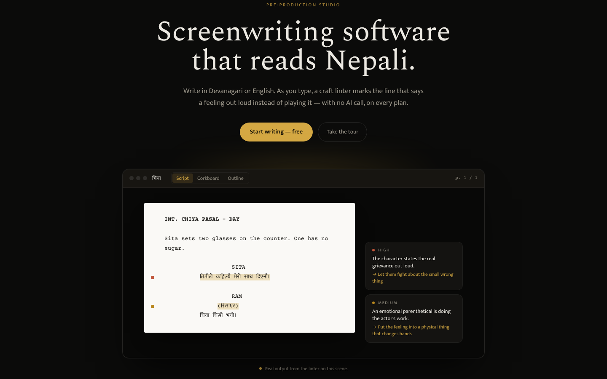
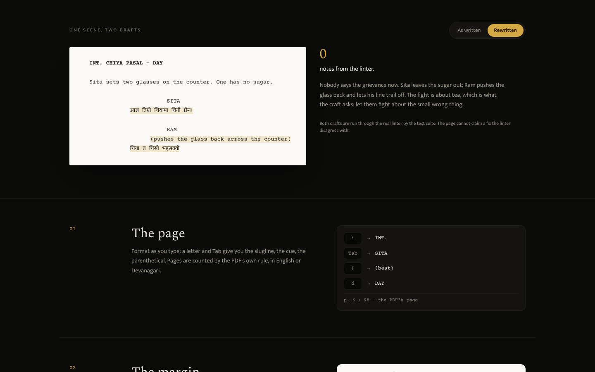
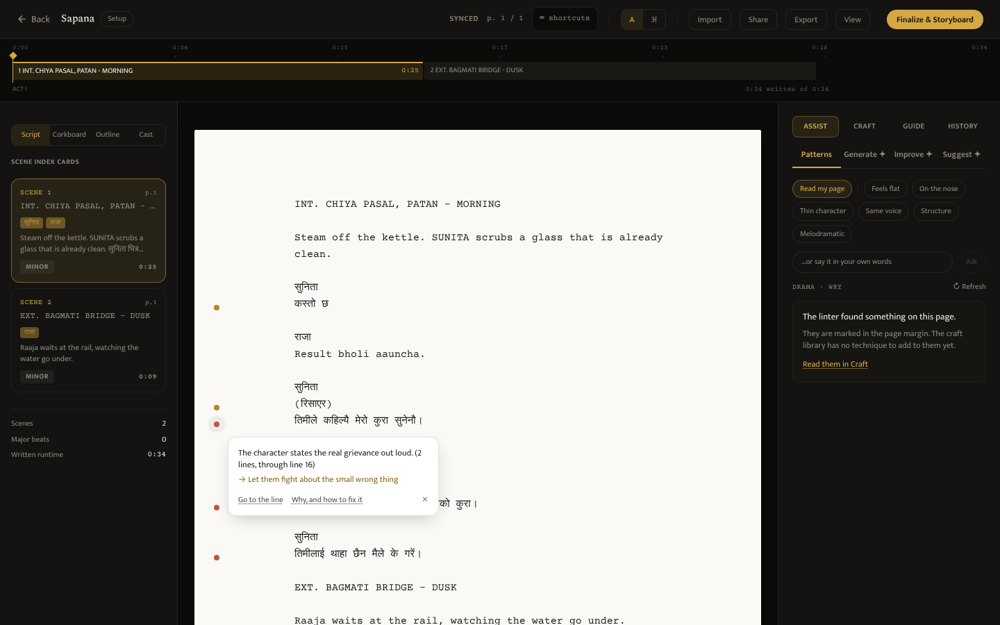
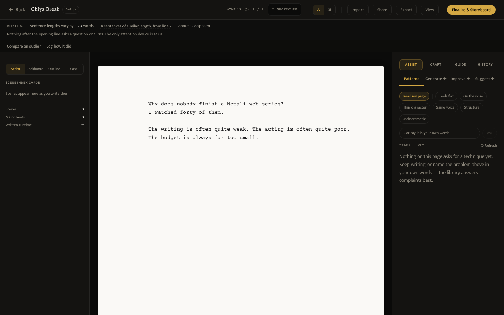
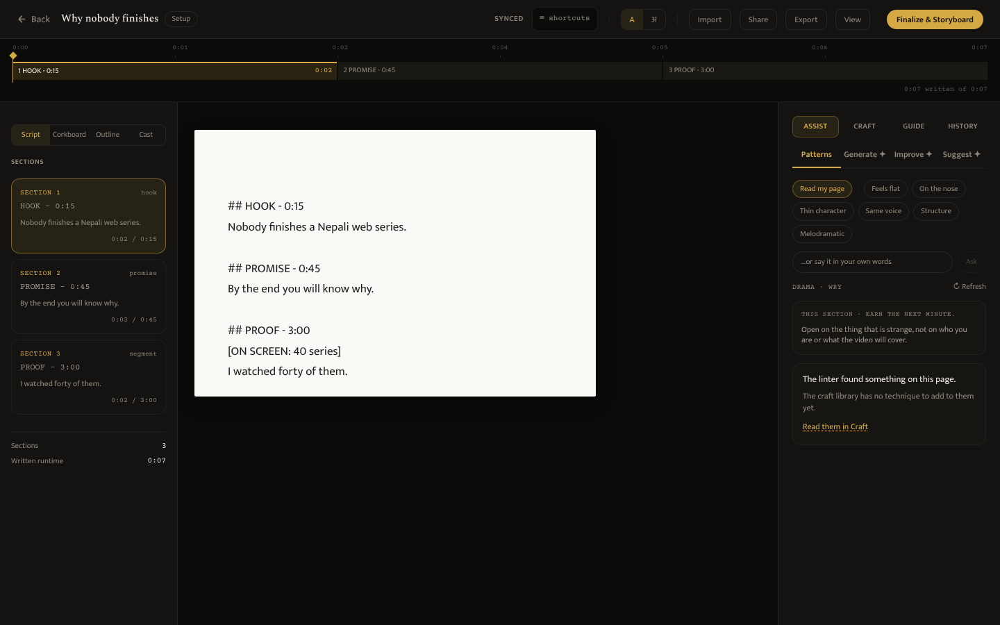
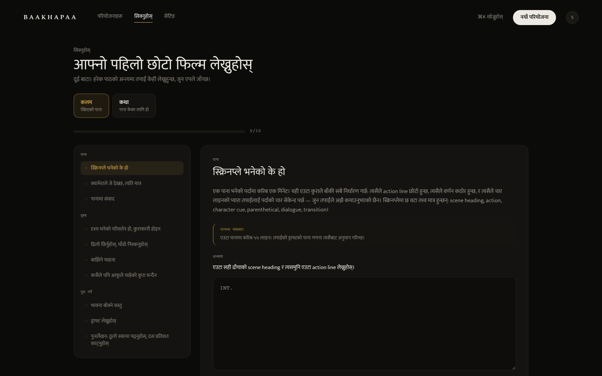

# Month 4 progress report

**Baakhapaa: AI-powered pre-production intelligence system**
Weeks 13 to 16 · Prepared for Baakhapaa · Reference: `MONTH_4_PROPOSAL.md`

The proposal promised four things. One was engineering, and it is done: **the
short-form scripting system now exists as a measured layer inside the
product**, not as a separate one. The other three were not engineering, and none
of them moved. No unproven path has run on the deployed system, no writer
outside this project has finished a script in it, and the proposal's success
measure was therefore neither demonstrated nor disproved.

That is the same gap Month 3 closed on, **built against proven**, and this
report keeps the two apart all the way through. Everything it says was built
was checked in a browser or by a test. Nothing it says was proven was proven.

The building went further than planned: **186 of the 200 tasks in
`MONTH_4_TASKS.md` are complete**, and about twenty defects that were on no
list were found by walking the product rather than by reading it. Section 4
treats that as the month's second result.

## 1. What the month produced

| | |
|---|---|
| Planned building tasks complete | **186 of 200** (`MONTH_4_TASKS.md`, counted by `check_docs.py`) |
| Proposal deliverables met | **1 of 4**: the short-form layer. The other three need the deployed system, money and writers |
| Commits on the branch since `codebase` | 55 |
| Suite size | **1,319 backend tests in 87 files; 1,585 frontend tests in 80 files** |
| Defects found that were on no plan | About 20, half of them found only by using the product in a browser |
| Retrieval, real queries | **91.3%** combined (Month 3). Two craft entries were added and **not re-measured** (section 6) |
| Real money moved | None |
| AI generation on the deployed system | None |

## 2. The page a stranger sees

`/` used to redirect to `/dashboard`, which bounced a visitor to a password
field. A stranger's first sight of the product was a login form.

It is now one claim, "Screenwriting software that reads Nepali", with the
product proving it underneath: the editor drawn in HTML, a Devanagari scene
typed onto the page, and the linter's notes arriving in the margin beside the
lines they name. That is the linter's **real output**, not an illustration: a
backend test lints the same scene and fails if the page and the linter ever
disagree. The three numbers under it each print the script in the repository
they come from, and the three rooms below draw the same screen replicas as the
tour, from one shared file. There are no testimonials, because there are none yet, and a
test pins that too. Crawlers that run no JavaScript now read 1,564 characters
of it instead of 33. First paint on throttled 4G is 884 ms, and that check is
now a CI step.

`/tour` is the second public page, for the visitor who wants to see the
product work before giving an email address:

One scene in two drafts. "As written" carries the linter's two notes. The
rewrite carries none, and **the test suite requires the linter to agree**: the
page cannot claim a fix the linter disputes. Other software (Final Draft,
Celtx, Arc Studio) is named only as somewhere the exported file opens, with a
line saying there is no partnership. Nothing on it says what any other product
lacks.

## 3. What a writer meets on the page

**Notes in the margin.** The linter's findings lived only in a side tab, as
"L13 · The character states the real grievance out loud", so a writer had to
open a panel and count down the page. Each flagged line now has a quiet dot
beside it, which opens below the line to show what was seen and the technique
that answers it.

The Assist tab used to say "No patterns matched — try writing a little more
first" over a page the linter had just flagged three times. An empty library
answer is not an empty diagnosis, and the two now say different things.

**Short-form, measured.** The rhythm meter reads the draft as it is typed. It
shows the spread of sentence length, names the flattest run by line, and notes
when nothing after the opening line asks a question or turns. The beat spine
marks where a rehook is due (every gap 5–8 s, on any runtime from 20 s to 3
min), and a creator can paste an outlier's transcript or log how their own
post did. Only numbers are stored, and a test reads the stored rows to prove
it. Below five results on each side of a comparison, the product says nothing
about them at all.

**Long-form video stopped borrowing the screenplay.** A video section was
shown with a page number, an "ACT I" label and screenplay milestones ("3
scenes, and none of them is marked a turning point"). All three were invented
for a format that has none of them. A section now shows its kind and its
written time against its target.

**Nepali, past the prose.** A signed-in writer could not change the interface
language inside the editor, and the editor toolbar was hard-coded English. The
course's module headers were English too. Worst, a writer doing the course in
Nepali **passed in Nepali and failed in English**: the grader's explanations
were never translated. All nine linter rules and the four grader messages now
answer in Nepali, and a test runs the real linter so that a reworded rule fails
the test instead of quietly falling back.

## 4. The defects that were on no list

The plan named four defects on Day 18. About twenty more were found, and the
way they were found matters more than the count: **most were invisible to a
suite that passed**. They showed up only when the product was opened in a
browser, at a phone's width, in Nepali, or through the interface instead of
the API.

The ones that would have stopped someone:

- **Course mode was unreachable.** It was built, tested and wired, but
  nothing in the interface set the video category, so every long-form project
  was an essay. Found by trying to walk a course lesson through the UI.
- **Opening the editor from a project link** loaded the script without its
  project. That switched off every format-specific feature for the session and
  titled the script "Untitled".
- **A letter typed straight after Tab** landed outside the B-roll cue Tab had
  just opened, because the caret moved one frame late.
- **Devanagari words were split at every vowel sign** by the rhythm and
  outlier measures, so a five-word sentence counted as twelve, and the danda
  ended no sentence.
- **Storyboard images were the one AI cost the monthly ceiling never
  counted.** They now spend credits, and the ceiling is shown to writers as
  credits instead of dollars.

The ones that would have misled:

- The new-project button said "Generate Project Structure" months after the
  wizard stopped generating one.
- The free-plan limit named `/pricing` as plain text and never mentioned the
  free way out.
- Letter-spaced capitals pulled Devanagari conjuncts apart.
- The layout check measured the width of the letter "x" in the system's
  fallback font. It would have failed on Linux CI while passing on Windows.
- A test shipped on the branch that could never pass, because jsdom has no
  layout. Another could never fail: it fed a complete script to a check for an
  incomplete one.

Every fix has a test that was seen to fail without it. `scripts/walk.mjs`,
which found the first group, is kept: it walks five journeys through the
interface and records every console error, failed request and stuck step.

## 5. Testing

| | Month 3 | Month 4 |
|---|---|---|
| Backend tests | 1,146 in 75 files | **1,319 in 87 files** |
| Frontend tests | 1,281 in 66 files | **1,585 in 80 files** |
| Browser checks | layout, contrast, responsive, load race | + landing page (CI), typewriter band, the walk |

One backend test does not run in the cloud session: it needs the embedding
model, which that session's network policy cannot download. It runs in CI.

## 6. What is not done

| | Waiting on |
|---|---|
| Retrieval re-measured with the two new craft entries | The embedding model: CI on the open PR, or a machine with it |
| `short_measurements` table on the real database | Applying the migration in `supabase_schema.sql` in the SQL editor |
| The two new entries in production retrieval | `load_knowledge_base.py` re-run against production |
| On-the-nose rule widened from evidence | Real drafts from the pilot (`PILOT.md` now asks for them) |
| The SDD ledger's deferred items | The ledger is in `.superpowers/`, which only exists on the original machine |
| AI generation and storyboards, live | Paid API credit |
| A completed customer payment | Khalti and eSewa merchant accounts |
| Renewal emails | An SMTP account |
| The legal documents | A Nepal-qualified lawyer |

The first five are small and mechanical. The last four are the same four that
closed Month 3, and none of them is engineering.

## 7. Month 5

**Merge, and let CI measure what this session could not.** The pull request
runs the retrieval eval with both floors. Screenplay p@1 must not move, and
the new video entries must hold their own.

**Then the proposal's three unmet deliverables, unchanged.** Buy the credit,
submit the merchant applications, and run the five-writer pilot from
`PILOT.md`. Building has gone as far as building can take this. The next number
worth having is how many writers finish a script, and only the pilot can
produce it.

---

Figures were captured from the running system with
`baakhapaa-frontend/scripts/capture-screenshots.mjs --only m4`, which leaves
the earlier months' figures untouched. Test and task counts were derived by
`baakhapaa-backend/check_docs.py`, not typed.
